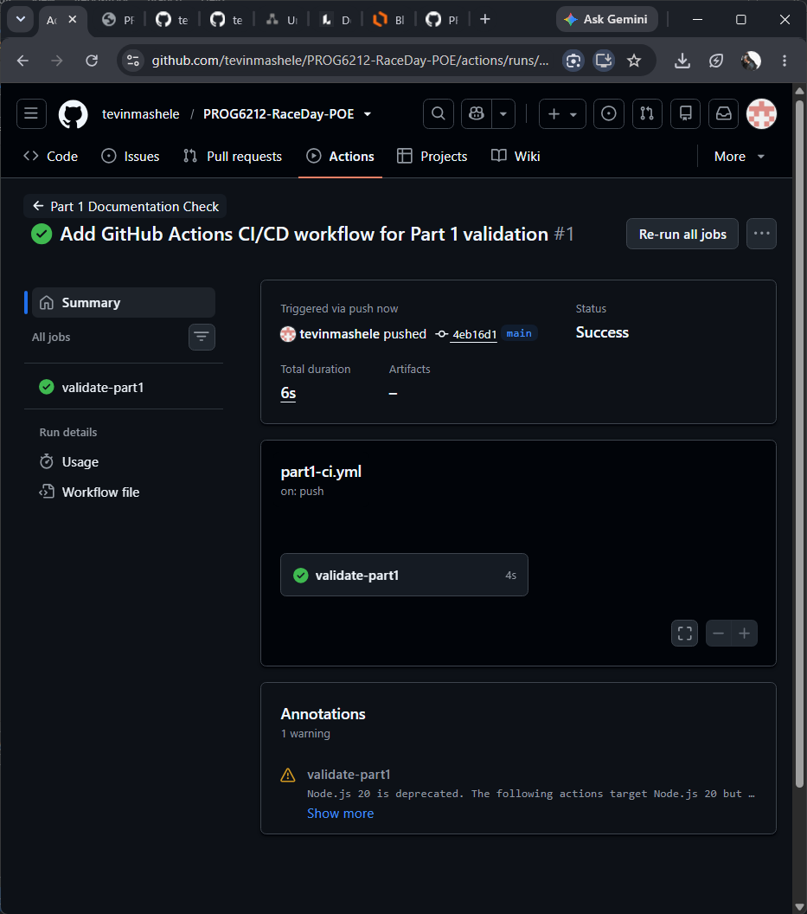

# RaceDay Event Management System

## Project Description
RaceDay is a full-stack web-based event management system designed specifically for the South African road running, walking, and cycling community. The platform allows Event Organisers to create and manage events, categories, and participant results, while Participants can browse upcoming events, enter events, track their personal performance history, and prepare for race day.

## Project Information
- Module: PROG6212 - Programming 2B
- Assessment: Part 1 - System Planning and Database
- Student: Buyelo Tevin Mashele
- Student Number: ST10478838

## User Roles

### Organiser
- Create, edit, and delete events
- Manage event categories
- View event enrolments
- Capture participant results
- View information relating to events they manage

### Participant
- Create an account and log in
- Browse available events
- Enter an event and select a category
- View their own enrolments
- Track their own race results and performance history

## Repository Structure
RaceDay/
├── .github/
│   └── workflows/
│       └── part1-ci.yml
├── docs/
│   ├── RaceDay_ERD.pdf
│   ├── RaceDay_API_Endpoint_Plan.pdf
│   └── RaceDay_Database.sql
├── green-build.png
└── README.md

## Part 1: System Planning and Database

### Deliverables
- Entity Relationship Diagram (ERD) with a minimum of six entities
- API Endpoint Plan covering authentication, events, categories, enrolments, and results
- SQL Database Script with tables, constraints, and realistic seed data
- GitHub Actions CI/CD workflow for repository validation
- Video Presentation demonstrating and explaining all planning documents

### Database Setup Instructions
1. Open SQL Server Management Studio (SSMS)
2. Connect to your SQL Server instance
3. Open File -> Open -> File and navigate to docs/RaceDay_Database.sql
4. Execute the script by pressing F5 or clicking the Execute button
5. The database RaceDayDB will be created with all tables and sample data
6. Verify the installation by running a query such as SELECT * FROM [User];

### Continuous Integration and Deployment
The GitHub Actions workflow validates the repository structure by checking that the following files exist:
- docs/RaceDay_ERD.pdf
- docs/RaceDay_API_Endpoint_Plan.pdf
- docs/RaceDay_Database.sql
- README.md

A green build confirmation screenshot is included below.

### Video Demonstration
YouTube Link: [https://youtu.be/YOUR_UNLISTED_LINK](https://youtu.be/YOUR_UNLISTED_LINK)

## References
- PROG6212 Part 1 Assessment Breakdown Document
- PROG6212 PoE Full Specification Document

---

Submitted as part of PROG6212 - Programming 2B