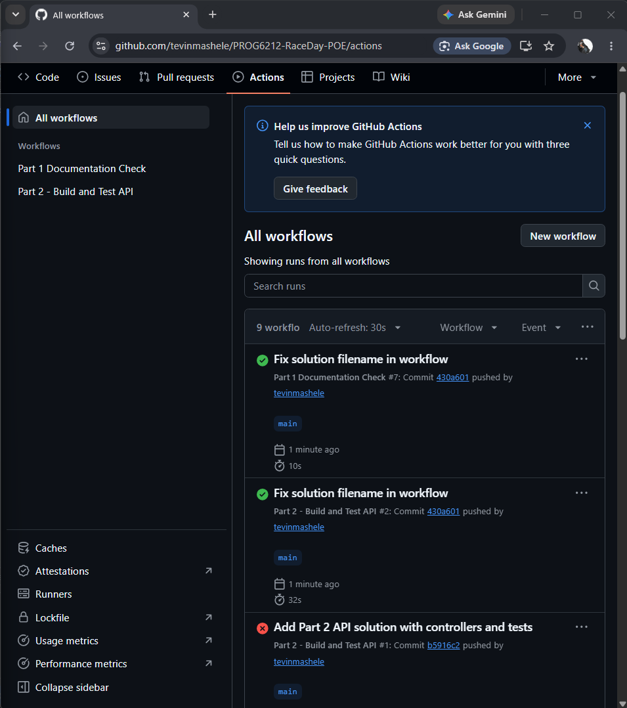

# RaceDay Event Management System

## Project Description
RaceDay is a full-stack web-based event management system designed specifically for the South African road running, walking, and cycling community. The platform allows Event Organisers to create and manage events, categories, and participant results, while Participants can browse upcoming events, enter events, track their personal performance history, and prepare for race day.

## Project Information
- Module: PROG6212 - Programming 2B
- Assessment: Part 1 - System Planning and Database
- Student: Buyelo Tevin Mashele
- Student Number: ST10478838

## User Roles

### Organiser
- Create, edit, and delete events
- Manage event categories
- View event enrolments
- Capture participant results
- View information relating to events they manage

### Participant
- Create an account and log in
- Browse available events
- Enter an event and select a category
- View their own enrolments
- Track their own race results and performance history

## Repository Structure
RaceDay/
├── .github/
│   └── workflows/
│       └── part1-ci.yml
├── docs/
│   ├── RaceDay_ERD.pdf
│   ├── RaceDay_API_Endpoint_Plan.pdf
│   └── RaceDay_Database.sql
├── green-build.png
└── README.md

## Part 1: System Planning and Database

### Deliverables
- Entity Relationship Diagram (ERD) with a minimum of six entities
- API Endpoint Plan covering authentication, events, categories, enrolments, and results
- SQL Database Script with tables, constraints, and realistic seed data
- GitHub Actions CI/CD workflow for repository validation
- Video Presentation demonstrating and explaining all planning documents

### Database Setup Instructions
1. Open SQL Server Management Studio (SSMS)
2. Connect to your SQL Server instance
3. Open File -> Open -> File and navigate to docs/RaceDay_Database.sql
4. Execute the script by pressing F5 or clicking the Execute button
5. The database RaceDayDB will be created with all tables and sample data
6. Verify the installation by running a query such as SELECT * FROM [User];

### Continuous Integration and Deployment
The GitHub Actions workflow validates the repository structure by checking that the following files exist:
- docs/RaceDay_ERD.pdf
- docs/RaceDay_API_Endpoint_Plan.pdf
- docs/RaceDay_Database.sql
- README.md

A green build confirmation screenshot is included below.

### Video Demonstration
YouTube Link: [https://youtu.be/YOUR_UNLISTED_LINK](https://youtu.be/1ftwoNgmMOE))

## References
- PROG6212 Part 1 Assessment Breakdown Document
- PROG6212 PoE Full Specification Document

---

Submitted as part of PROG6212 - Programming 2B

## Part 2: RESTful API

### Deliverables
- RESTful API built in C# using ASP.NET Core Web API
- SQL Server database via Entity Framework Core (Code First)
- Role-based authentication for Organiser and Participant
- Unit tests for authentication, events, enrolments, and results
- GitHub Actions CI/CD pipeline

### Technologies Used
- .NET 10
- ASP.NET Core Web API
- Entity Framework Core
- SQL Server (LocalDB)
- xUnit (testing)
- GitHub Actions (CI/CD)

### Project Structure

PROG6212-RaceDay-POE/
├── RaceDay.Api/ (API project with controllers, models, DTOs)
├── RaceDay.Api.Tests/ (Unit tests)
├── RaceDay.Contracts/ (Shared DTOs)
└── RaceDay.slnx (Solution file)

### How to Run the API
1. Open the solution in Visual Studio
2. Set `RaceDay.Api` as the startup project
3. Press F5 to run
4. Swagger UI opens in your browser

### API Endpoints
All endpoints are exposed through Swagger. Navigate to `https://localhost:7078/swagger` while the API is running.

| Category | Endpoints |
|----------|-----------|
| Authentication | Register, Login, Logout |
| Profile | Get Profile, Update Profile |
| Events | Get All, Get One, Create, Update, Delete |
| Categories | List, Create, Update, Delete |
| Enrolments | Create, View Mine, View Event Enrolments, Withdraw |
| Results | Capture, View Mine, View Event Results |

### Authentication
- Session-based authentication
- Passwords hashed using SHA-256
- Role-based access control via custom filter
- Two roles: Organiser, Participant

### Unit Testing
Run tests locally:

### How to Run the API
1. Open the solution in Visual Studio
2. Set `RaceDay.Api` as the startup project
3. Press F5 to run
4. Swagger UI opens in your browser

### API Endpoints
All endpoints are exposed through Swagger. Navigate to `https://localhost:7078/swagger` while the API is running.

| Category | Endpoints |
|----------|-----------|
| Authentication | Register, Login, Logout |
| Profile | Get Profile, Update Profile |
| Events | Get All, Get One, Create, Update, Delete |
| Categories | List, Create, Update, Delete |
| Enrolments | Create, View Mine, View Event Enrolments, Withdraw |
| Results | Capture, View Mine, View Event Results |

### Authentication
- Session-based authentication
- Passwords hashed using SHA-256
- Role-based access control via custom filter
- Two roles: Organiser, Participant

### Unit Testing
Run tests locally:

All 10 tests should pass. The GitHub Actions workflow runs them automatically on every push.

### CI/CD
The workflow builds the API and runs all tests on every push to main.

### Part 2 Video
YouTube Link: [https://youtu.be/PART2_LINK](https://youtu.be/PART2_LINK)
