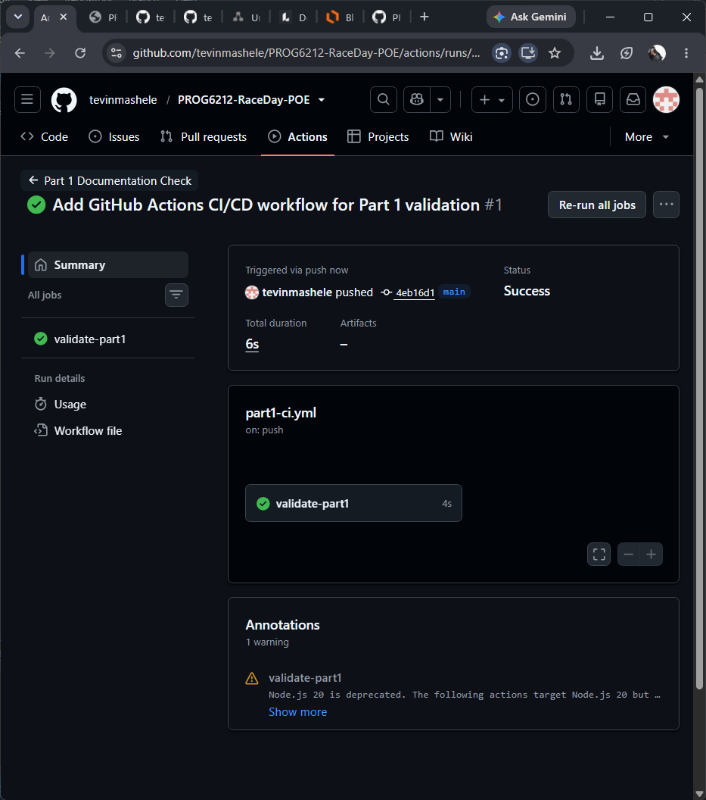

# RaceDay Event Management System

## Project Description
RaceDay is a full-stack web-based event management system designed specifically for the South African road running, walking, and cycling community. The platform allows Event Organisers to create and manage events, categories, and participant results, while Participants can browse upcoming events, enter events, track their personal performance history, and prepare for race day.

## Project Information
- Module: PROG6212 - Programming 2B
- Assessment: Part 1 - System Planning and Database
- Student: Buyelo Tevin Mashele
- Student Number: ST10478838

## User Roles

### Organiser
- Create, edit, and delete events
- Manage event categories
- View event enrolments
- Capture participant results
- View information relating to events they manage

### Participant
- Create an account and log in
- Browse available events
- Enter an event and select a category
- View their own enrolments
- Track their own race results and performance history

## Repository Structure
RaceDay/
├── .github/
│   └── workflows/
│       └── part1-ci.yml
├── docs/
│   ├── RaceDay_ERD.pdf
│   ├── RaceDay_API_Endpoint_Plan.pdf
│   └── RaceDay_Database.sql
├── green-build.png
└── README.md

## Part 1: System Planning and Database

### Deliverables
- Entity Relationship Diagram (ERD) with a minimum of six entities
- API Endpoint Plan covering authentication, events, categories, enrolments, and results
- SQL Database Script with tables, constraints, and realistic seed data
- GitHub Actions CI/CD workflow for repository validation
- Video Presentation demonstrating and explaining all planning documents

### Database Setup Instructions
1. Open SQL Server Management Studio (SSMS)
2. Connect to your SQL Server instance
3. Open File -> Open -> File and navigate to docs/RaceDay_Database.sql
4. Execute the script by pressing F5 or clicking the Execute button
5. The database RaceDayDB will be created with all tables and sample data
6. Verify the installation by running a query such as SELECT * FROM [User];

### Continuous Integration and Deployment
The GitHub Actions workflow validates the repository structure by checking that the following files exist:
- docs/RaceDay_ERD.pdf
- docs/RaceDay_API_Endpoint_Plan.pdf
- docs/RaceDay_Database.sql
- README.md

A green build confirmation screenshot is included below.

### Video Demonstration
YouTube Link: [https://youtu.be/YOUR_UNLISTED_LINK](https://youtu.be/1ftwoNgmMOE))

## References
- PROG6212 Part 1 Assessment Breakdown Document
- PROG6212 PoE Full Specification Document

---

Submitted as part of PROG6212 - Programming 2B

Part 2: RESTful API
Deliverables
RESTful API built in C# using ASP.NET Core Web API.

SQL Server database via Entity Framework Core (Code First).

Role-based session authentication for Organiser and Participant.

Unit tests for authentication, events, enrolments, and results.

GitHub Actions CI/CD pipeline.

Technologies Used
.NET 10

ASP.NET Core Web API

Entity Framework Core

SQL Server (LocalDB)

xUnit (testing)

GitHub Actions (CI/CD)

API Setup Instructions
Open the solution in Visual Studio.

Update the database connection string in RaceDay.Api/appsettings.json if necessary.

Set RaceDay.Api as the startup project and press F5.

The Swagger UI will open at https://localhost:7078/swagger.

Unit Testing
Run tests locally:

bash
dotnet test RaceDay.slnx
All 10 tests should pass. The GitHub Actions workflow runs them automatically on every push.

CI/CD
The workflow builds the API and runs all tests on every push to main.

https://green-build-part2.png/

Part 2 Video Demonstration
YouTube Link: https://youtu.be/PART2_LINK

Part 3: MVC Web Application, Azure Blob Storage & Docker
Deliverables
ASP.NET Core MVC Web Application communicating with the Part 2 API.

Session-based authentication and role-specific interfaces.

Azure Blob Storage integration (using local Azurite emulator).

Full Docker containerisation of the MVC application.

Consistent UI design using Bootstrap.

MVC Setup Instructions
Open the solution in Visual Studio.

Ensure both RaceDay.Api and RaceDay.Mvc are set to start.

Start the Azurite emulator (via Command Prompt: azurite --silent or the Visual Studio extension) to enable image uploads.

Press F5 to run. The MVC app will open in your browser.

Docker Setup
The MVC application is fully containerised.

1. Build the Docker Image:
Open a terminal in the solution root folder and run:

bash
docker build -f RaceDay.Mvc/Dockerfile -t raceday-mvc:part3 .
2. Run the Container:
(Note: Ensure the RaceDay.Api is running locally on http://localhost:5000 for the container to connect).

bash
docker run -d -p 8080:8080 --name raceday-mvc -e ApiSettings__BaseUrl=http://host.docker.internal:5000/ raceday-mvc:part3
3. Access the application:
Open http://localhost:8080 in your browser.

Part 3 Video Demonstration
YouTube Link: https://youtu.be/YOUR_PART3_LINK
